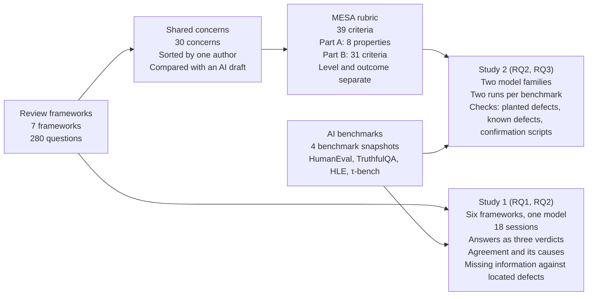

# Overview of the method and the two studies

The image `mesa_study_overview.pdf` (and `mesa_study_overview.png`) is produced by `mesa_study_overview.tex` (compile with pdflatex); the Mermaid block below is a text version with the same boxes and arrows.

