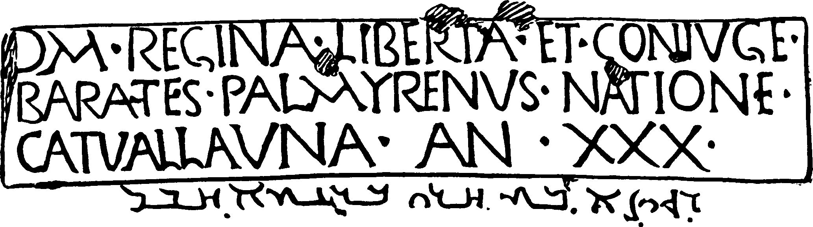
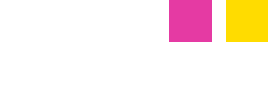
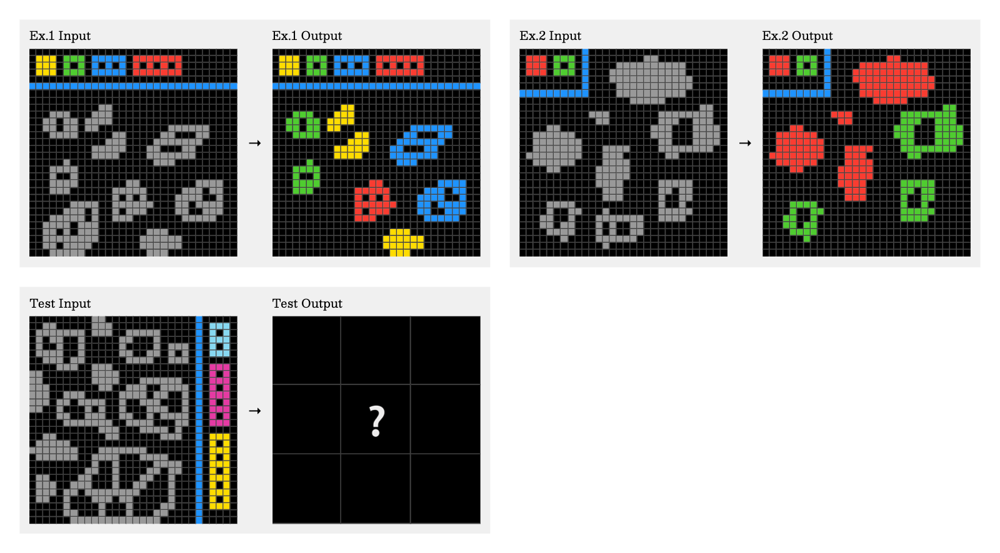

# MESA: Adapting and Testing an EFPA-Based Framework for AI Benchmark Review

Guided colleague survey

## 1. Introduction

This survey introduces MESA, the Meta-Evaluation Standard for AI Benchmarks, a questionnaire for reviewing AI tests. It covers three benchmarks: Humanity’s Last Exam (advanced academic knowledge and reasoning questions), ARC-AGI-2 (visual grid reasoning and rule learning), and DesignQA (engineering questions from student racecar design and technical rulebooks). First describe your familiarity with AI and read the completed Humanity’s Last Exam example, then review ARC-AGI-2; you can stop after submitting it or choose to review DesignQA as well.

You review the tests rather than solve their problems. Read the supplied passages and make your own judgments. Complete and submit 25 questions about ARC-AGI-2; you can then stop or choose to review DesignQA. Each benchmark has its own feedback and submission. Comments are optional; evidence notes and citations are not required.

## How to choose an answer

Choose one option for each question.

- **Yes:** Information supports the whole condition.

- **Partly:** Supports some parts but not all.

- **No:** Information shows the condition is not met.

- **Not sure:** Information is missing, unclear, or insufficient.

- **Not applicable:** The issue does not apply.

When information is missing, choose **Not sure** rather than **No**.

For a question asking whether checking or testing occurred, **Yes** means the stated checks occurred for all parts of the question, not that results were favourable or every error was eliminated. **Partly** means that only some of those checks or parts are supported. Describe limits in coverage in an optional comment; do not lower an answer solely because checking found errors or disagreement.

Each answer records your judgment about one part of the benchmark. The answers are not added together to produce a total quality score.

No name or email is requested. Please avoid identifying details in comments. Each submission sends familiarity ratings, one benchmark review, feedback, survey identifier and fingerprint, session identifier, and completion time to the organizer through FormSubmit; the external service may process technical request information.

The online form supplies definitions beside relevant words. In this printable companion, the same definitions appear in a reference section at the end.

## 2. Your familiarity

These are your own descriptions, not a knowledge test. Choose one response to each question.

**How familiar are you with AI?**

Think about your experience using or learning about AI, such as a chatbot. This is your own description, not a knowledge test.

- ☐ 1 — New to me: I have little or no experience with AI.
- ☐ 2 — A little familiar: I have heard about or tried AI.
- ☐ 3 — Somewhat familiar: I use AI sometimes and understand its basic purpose.
- ☐ 4 — Familiar: I use AI regularly and understand some of its limits.
- ☐ 5 — Very familiar: I can explain how AI is used and discuss its limits confidently.

**How familiar are you with AI benchmarks?**

An AI benchmark is a test used to assess an AI system. Think about how familiar this idea was before reading this survey.

- ☐ 1 — New to me: I had not heard of AI benchmarks.
- ☐ 2 — A little familiar: I had heard the term but could not explain it.
- ☐ 3 — Somewhat familiar: I knew that benchmarks test AI and produce scores.
- ☐ 4 — Familiar: I knew how some benchmark problems and scores are used.
- ☐ 5 — Very familiar: I could explain benchmarks and discuss what their scores can and cannot show.

**How confident are you about interpreting AI test scores?**

Interpreting a score means deciding what a result tells us, such as whether two AI systems can be compared fairly. Choose how confident you feel now.

- ☐ 1 — Not confident: I would need help understanding a test score.
- ☐ 2 — Slightly confident: I understand a simple score but need help comparing results.
- ☐ 3 — Moderately confident: I can explain a basic score and recognize some limits.
- ☐ 4 — Confident: I can compare results and explain important limits.
- ☐ 5 — Very confident: I can explain why a comparison is fair or uncertain and what evidence is needed.

## 3. HLE — answered example

This completed example shows one reviewer’s judgments based on the supplied reading and inspected sources. It is a teaching example, not a correct-answer key or a validated assessment of HLE.

Humanity’s Last Exam tests academic knowledge and reasoning through questions, sometimes with images. Read the passage and completed MESA answers to see how a benchmark review works; you do not need to answer anything on this page.

**Which test this survey covers:** The original 2,500-question HLE described in the supplied paper, with the simple public evaluation code inspected on 7 October 2026. This survey does not cover HLE-Rolling, HLE-Diamond or their evaluations with extra tools.

**How to interpret its scores:** Using scores to compare AI systems on difficult academic questions, and considering claims about academic expertise beyond the exact questions.

### Reading passage

#### What the AI is asked to do

Humanity’s Last Exam, or HLE, assesses advanced academic knowledge and reasoning in AI systems that handle text or both text and images. This survey examines **original HLE, which contains 2,500 difficult questions**, rather than the separate HLE-Rolling and HLE-Diamond versions. About **24% of its questions are multiple choice**, while the remaining 76% require short answers, and about **14% include an image**. For example, a published biology question asks for a specific anatomical measurement of a hummingbird bone. You do not need to solve that question for this survey; it illustrates the kind of specialist question the AI receives. Across all subjects, HLE asks for definite answers rather than open-ended research. Sources: [HP](#source-HP) [HW](#source-HW).

**A real HLE image question**

In this example, the AI receives an image of an ancient inscription and is asked to translate the Palmyrene writing along the bottom. The image provides information needed to answer the question; you do not need to translate it for this survey.

Official classics example from the Humanity’s Last Exam website. The question is summarized here. [Source figure](https://lastexam.ai/_next/static/media/classics.81111c73.png).

#### How the questions were chosen and checked

Subject matter experts from many institutions contributed questions covering a broad range of disciplines, with mathematics being the largest subject area. Before expert review, questions that contemporary AI models could already solve were removed, so the benchmark was **deliberately designed to be difficult**, rather than a random sample of everyday academic work. The authors describe their development procedure in a research paper, reporting expert review and organizer approval, followed by two separate audits of 200 questions each. After the second audit, the authors estimated an **expert disagreement rate of 15.4%**. This figure reflects genuine disagreements among experts about questions or answers; it is not the percentage confirmed to be wrong. Because questions require definite answers, open-ended research and creative work remain outside the scope of the exam. Sources: [HP](#source-HP).

**HLE question distribution across academic subjects**

| Subject | Questions | Share of Exam | Definite Answer Type |
| --- | --- | --- | --- |
| Mathematics | 910 | 36.4% | Short answer or multiple choice |
| Physics | 390 | 15.6% | Short answer or multiple choice |
| Chemistry | 332 | 13.3% | Short answer or multiple choice |
| Biology and Medicine | 298 | 11.9% | Short answer or multiple choice |
| Computer Science | 285 | 11.4% | Short answer or multiple choice |
| Humanities and Social Sciences | 285 | 11.4% | Short answer or multiple choice |

Subject breakdown for the 2,500 questions in original HLE. Mathematics represents over a third of all questions. Definite answers are required across all subjects. Sources: [HP](#source-HP).

#### Instructions and marking

The public evaluation software gives the AI each question, attaches an image when present, and asks for an explanation, a final answer, and a stated confidence percentage. The documentation describes a default temperature of zero to reduce randomness during generation, but the line that sends this setting is **disabled in the inspected code**. Once the AI produces an answer, a separate **AI judge compares that answer with the reference answer**, accepting different phrasing when the meaning is identical. Because the judge only compares the two texts rather than independently solving the problem, agreement does not guarantee that the reference answer is correct. The judge code is public, but the inspected materials contain no full study comparing its marks against expert human marks. The expert checks of the questions during development do not by themselves show that the automated marking software is accurate. Sources: [HM](#source-HM) [HR](#source-HR) [HJ](#source-HJ) [HP](#source-HP).

**How an HLE answer is marked**

1. **Receive a question** — Text, sometimes with an image; choose an option or give a short answer.
2. **Give a response** — The AI provides an explanation, a final answer and its stated confidence.
3. **Compare with the reference** — A separate AI judge checks the final answer against the supplied answer. Equivalent meanings can count.

Process diagram based on the simple evaluation code. The judge is not asked to solve the question independently.

#### What the reported numbers mean

HLE reports **accuracy as the percentage of answers marked correct**, where every question receives equal weight. Consequently, subjects with more questions have a larger effect on the total score. The paper also reports accuracy separately by academic subject, though the documentation does not show that these subject scores reflect distinct underlying abilities. Alongside accuracy, the scoring software computes an **approximate 95% confidence range** based on the number of questions and the proportion marked correct. This range describes score uncertainty under specific statistical assumptions; it does not measure score changes from rerunning the AI or changing the judge. A separate calibration calculation compares the AI’s stated confidence with its actual accuracy. As a result, the AI’s stated confidence and statistical score uncertainty refer to two completely different things. Sources: [HP](#source-HP) [HJ](#source-HJ).

**Three different numbers in the results**

1. **Accuracy** — What percentage of answers were marked correct?
2. **Score range** — How uncertain is that percentage under the calculation used? This is not a repeated-run test.
3. **Confidence check** — Does how confident the AI says it is match how often it is correct?

These are separate summaries of the answers. None substitutes for measuring changes across repeated runs.

**HLE official baseline accuracy and calibration error**

| Model | Full Set (2,500 questions) | Text Subset (2,157 questions) | ECE (Calibration Error) |
| --- | --- | --- | --- |
| GPT-4o (2024-05-13) | 2.7% | 3.0% | 0.088 |
| Claude 3.5 Sonnet (2024-06-20) | 3.6% | 4.3% | 0.098 |
| Gemini 1.5 Pro (2024-08-01) | 4.0% | 4.4% | 0.103 |
| o1-preview (2024-09-12) | 7.7% | 8.2% | 0.078 |
| Random guess baseline | 0.0% | 0.0% | — |

Official model results reported in the HLE paper. Full exam has 2,500 questions; text subset has 2,157 questions. Expected calibration error (ECE) measures the difference between stated confidence and actual correctness. Sources: [HP](#source-HP).

#### Comparisons and repeated testing

To provide context for scores, the paper compares several named AI models across both the full question set and a text-only subset. Although academic specialists wrote the questions, the inspected records contain **no matched group of human experts taking the entire exam under the same conditions**. The paper acknowledges that an AI model can give different answers across separate attempts, but the supplied sources provide no repeated testing study measuring score consistency for the main comparisons. They also provide no systematic experiments measuring score changes when instructions are reworded or when different versions of the AI judge are used. Using a fixed prompt or setting does not by itself reveal how stable test scores remain. Sources: [HP](#source-HP) [HM](#source-HM) [HJ](#source-HJ).

#### Data contamination and ways to earn points

To reduce easy ways to earn points, question contributors were asked to avoid questions answerable by simple web search, and could update questions if an AI guessed correctly through flawed reasoning. However, multiple choice questions still permit guessing, and the documentation does not measure every possible shortcut. The creators also kept a **private test set** to check whether AI models overfit to public questions. For public data, a distinctive text marker helps developers detect and exclude benchmark questions from training data, while the instructions warn against training directly on the test. These precautions do not show whether any specific AI model encountered the test questions before evaluation. Furthermore, the records lack a complete policy covering repeated submissions, access to feedback, and rules for models trained specifically on HLE. Sources: [HP](#source-HP) [HR](#source-HR).

#### Access, fair comparisons and updates

Fair comparisons require comparable testing conditions across systems. Because vision-language models and text-only models do not answer the same questions, the paper reports text-only results separately. All questions are in English and subject representation varies, with no comprehensive studies examining fairness across languages or cultural contexts. The evaluation instructions and scoring software are publicly available for inspection, but downloading the questions requires accepting contact sharing conditions, and the private test set remains withheld. The dataset lists an MIT license alongside a request not to redistribute questions, and the code carries an MIT license. Dangerous topics were screened out during collection. When comparing scores over time, benchmark editions matter: HLE-Rolling maintains its own change log of removed and restored questions, and **those changes do not describe original HLE**. The materials supply no study establishing score equivalence across original HLE, HLE-Rolling, and HLE-Diamond. Sources: [HP](#source-HP) [HR](#source-HR) [HC](#source-HC) [HJ](#source-HJ) [HL](#source-HL) [HW](#source-HW) [HU](#source-HU).

#### What the findings cover

While the benchmark’s title suggests a comprehensive examination at the frontier of human knowledge, the paper restricts its interpretation to difficult academic questions with definite answers. The authors explicitly state that **a high score alone does not establish general intelligence or the ability to carry out independent scientific research**. In line with this boundary, the documentation contains no measured link between HLE scores and success on independent scientific projects. Recognizing these limits clarifies what the test shows without implying that the benchmark fails its stated purpose. Sources: [HP](#source-HP).

### Answered questions

### Description

**Example Q1. Are the benchmark version, set of test problems and method for calculating scores identified?**

**Meaning:** Identify the edition of the benchmark, the problems used, and the scoring method. This asks whether all three are stated, not whether they are good choices.

**Answer: Yes**

Why: The passage identifies original HLE and its 2,500 questions. A judging AI compares responses with reference answers, and accuracy is the percentage marked correct, so both the test and its scoring method are described. Sources: [HP](#source-HP) [HW](#source-HW).

**Example Q2. Are the ability being tested, the intended AI systems and the intended uses described?**

**Meaning:** Look for the ability being tested, which AI systems the test is intended for, and the proposed uses of its scores. A description of these aims is different from evidence that the test achieves them.

**Answer: Yes**

Why: HLE tests academic knowledge and reasoning in AI systems that handle text or text and images. Its scores are intended to compare these systems on academic questions; they do not by themselves establish research ability or general intelligence. Sources: [HP](#source-HP).

**Example Q3. Are the test problems, the information provided and the required answers or actions described?**

**Meaning:** The description should say what the AI receives and what it must produce or do. You do not need to solve the problems yourself.

**Answer: Yes**

Why: The AI receives a question, sometimes with an image, and selects an option or gives a short answer. The evaluation software asks for an explanation, a final answer and a percentage stating confidence. Sources: [HP](#source-HP).

**Example Q4. Are the instructions, resources and limits for taking the test described?**

**Meaning:** Testing conditions include instructions, tools, supplied documents, time, allowed attempts, and AI settings. This asks whether relevant conditions are described, not whether every possible condition was studied.

**Answer: Partly**

Why: The software describes the instructions and a temperature setting of zero to reduce randomness. However, the line that sends that setting is disabled in the inspected code, so the description does not establish that it was used. Sources: [HM](#source-HM) [HR](#source-HR).

**Example Q5. Is it described how answers or actions become scores and how results are presented?**

**Meaning:** Look for the rules that turn responses into points, any averaging or weighting, and how results are shown. Describing a scoring rule does not establish that it is accurate or appropriate.

**Answer: Yes**

Why: An AI judge compares each final answer with a reference, accepting equivalent meanings. The code reports the percentage marked correct, a confidence range and how stated confidence compares with accuracy; describing these calculations does not establish that they work well. Sources: [HJ](#source-HJ).

### Purpose and development

**Example Q6. Is it explained why the test problems measure the ability the benchmark claims to test?**

**Meaning:** The explanation should link the problems to the claimed ability. Being difficult or requiring specialist knowledge does not by itself establish that a task measures reasoning.

**Answer: Yes**

Why: The paper uses specialist academic questions with definite answers to test knowledge and reasoning that existing AI models struggle with. This explains the choice of tasks, but does not establish coverage of every academic ability. Sources: [HP](#source-HP).

**Example Q7. Are the sources and choice of test problems justified for the benchmark’s intended use?**

**Meaning:** Look for reasons for the sources, number, topics, and difficulty of problems in relation to the intended use. Availability alone is not a reason that these problems represent the ability.

**Answer: Partly**

Why: Experts contributed questions, and questions that selected AI models could already answer were screened out. This explains how difficulty was chosen, but does not show that the resulting set represents academic work more generally. Sources: [HP](#source-HP).

**Example Q8. Were the test problems and the answers used to mark them checked for errors during development?**

**Meaning:** This asks whether both the problems and the supplied answers used to mark them were examined for mistakes during development. It is separate from testing how new AI responses are marked. Evidence that examination occurred does not establish that every answer is correct; note limits in its coverage when relevant.

**Answer: Yes**

Why: Expert review and organizer approval were followed by two checks of 200 questions each, examining questions and reference answers. The reported 15.4% expert disagreement limits confidence in the answers, but does not negate that checking occurred. Sources: [HP](#source-HP).

**Example Q9. Is there evidence that the test problems cover the relevant parts of the ability being claimed?**

**Meaning:** An ability may have several relevant parts. Look for evidence that the selected problems cover the parts included in the claim. A narrow set of problems may fit a narrow claim but not a broader one.

**Answer: Partly**

Why: The questions span many subjects but emphasize mathematics and require definite answers. This covers some academic knowledge and reasoning, while creative work and research without a fixed answer fall outside the format. Sources: [HP](#source-HP).

### Scoring and comparisons

**Example Q10. Is there evidence that the way points are awarded reflects the ability the benchmark is meant to measure?**

**Meaning:** Look for evidence that earning more points means doing better at the intended ability. A fixed scoring rule can work exactly as written while rewarding formatting or other features unrelated to that ability.

**Answer: Partly**

Why: The judge accepts responses that mean the same thing as the reference answer, allowing differences in wording. However, it compares answers without independently solving the problem, so a mistaken reference or judging decision can affect the score. Sources: [HJ](#source-HJ) [HP](#source-HP).

**Example Q11. If several scores are combined into an overall score, or separate subscores are reported, is there a clear reason for doing so?**

**Meaning:** Look for reasons when results are combined into an overall score or reported as separate subscores. Averaging numbers is a calculation; it does not by itself prove that the total measures a single unified ability.

**Answer: Partly**

Why: Every question counts equally toward accuracy, so subjects with more questions contribute more to the total. Results are also reported by subject, but the supplied material does not establish that these subject scores measure separate abilities. Sources: [HP](#source-HP) [HJ](#source-HJ).

**Example Q12. Was the marking method checked for mistakes, such as software bugs, mistakes when reading the AI's answer, or inconsistent human or AI judges?**

**Meaning:** Marking can be done by people, fixed software rules, or another AI. This asks whether that method was checked for errors such as software bugs, mistakes when reading the AI's answer, or inconsistent judges. A check that found errors still counts as a check.

**Answer: Not sure**

Why: The code shows how the AI judge compares responses with reference answers, but no full comparison with expert marking is supplied. Expert checks of the questions do not establish whether this judge marks AI responses correctly and consistently. Sources: [HJ](#source-HJ) [HP](#source-HP).

**Example Q13. Are the comparison points used to explain the scores justified for the claims being made?**

**Meaning:** A comparison point is a human score, another AI score, or a guessing result used to interpret a score. Ask whether it fits the stated claim and conditions. Comparing particular systems does not establish a ranking among all systems or a justified score cutoff for a decision.

**Answer: Partly**

Why: The paper compares AI models on the full question set and separately on questions using only text. These provide context, but no matched group of people takes the whole exam under the same conditions, limiting comparisons with human performance. Sources: [HP](#source-HP).

### Consistency of results

**Example Q14. Was the same AI tested more than once under the same setup to check whether its score stays consistent?**

**Meaning:** This asks whether the same AI was tested more than once under identical conditions to measure how much its score changes. A single reported test run does not show whether repeated scores stay consistent.

**Answer: Not sure**

Why: The paper acknowledges that an AI can answer differently on separate attempts. The supplied sources do not establish repeated testing of the same systems for the main comparisons, so the size of score changes remains unknown. Sources: [HP](#source-HP) [HM](#source-HM).

**Example Q15. Was it tested how much scores change when instructions, presentation or the testing setup change?**

**Meaning:** This asks whether the benchmark tested how scores change when instructions, presentation, or settings change. Repeating identical conditions is different from changing conditions. Findings about one change need not cover every possible change.

**Answer: Not sure**

Why: The supplied sources do not establish systematic tests of reworded instructions or changes to the judging AI. Describing one instruction and testing setup does not show how much scores change when those conditions change. Sources: [HP](#source-HP) [HJ](#source-HJ) [HM](#source-HM).

**Example Q16. Are estimates of how much scores could vary provided in enough detail to support the comparisons or decisions being made?**

**Meaning:** Look for a range or other estimate of possible score differences, how it was calculated, and whether it supports the intended comparison. An estimate based on the number of problems need not measure changes across repeated evaluations; small score differences may remain unresolved.

**Answer: Partly**

Why: The code estimates a 95% confidence range from the number of questions and the fraction marked correct. It does not measure changes from rerunning the AI or replacing the judge, so it covers only some uncertainty in comparisons. Sources: [HJ](#source-HJ).

### Meaning and fairness

**Example Q17. Were ways of earning points without using the ability being tested investigated?**

**Meaning:** A shortcut earns points without the intended ability, for example through accidental clues or simple lookups. This asks whether such routes were investigated. Identifying a possible shortcut does not establish that a tested AI used it; an investigation that found a problem still occurred.

**Answer: Partly**

Why: Contributors were asked to avoid questions answered by a simple lookup and could update questions answered through faulty reasoning. These checks address some shortcuts, but guessing remains possible and the supplied material does not measure every route to points. Sources: [HP](#source-HP).

**Example Q18. Was the risk that AI systems had already seen the test problems or answers assessed and addressed?**

**Meaning:** Look for both an assessment of the risk of data contamination and steps to address that risk. Public availability may create a risk without proving that a particular model saw the material. Protective measures do not establish that data contamination was impossible.

**Answer: Partly**

Why: HLE keeps some questions private, marks public test data and warns against using it for training. These measures help limit data contamination, but the supplied information does not show whether an AI was trained on any of the public questions or answers. Sources: [HP](#source-HP) [HR](#source-HR).

**Example Q19. Are the rules on training specifically for this test and repeatedly submitting results justified for the intended use?**

**Meaning:** Look for rules about training specifically for the test and repeatedly submitting results, with reasons linked to the intended use. A rule being absent from the supplied description is different from evidence that the rule is unsuitable.

**Answer: Not sure**

Why: The instructions discourage training on test questions. However, the supplied material lacks a complete policy covering repeated submissions, access to feedback and reporting systems trained for HLE, leaving insufficient information to judge whether the rules support the intended comparisons. Sources: [HR](#source-HR).

**Example Q20. Is there evidence for any claim that the scores show how well an AI system will perform beyond the problems in this test?**

**Meaning:** This concerns claims about new problems or real work beyond the benchmark. Look for evidence covering that broader claim. A stated ambition alone is not such evidence; if no broader claim or use arises, consider Not applicable.

**Answer: Not sure**

Why: The supplied passage reports no measured relationship between HLE scores and success on independent scientific projects. Academic question scores therefore leave that broader claim unresolved; missing evidence does not prove that an AI cannot conduct research. Sources: [HP](#source-HP).

**Example Q21. Is there evidence that comparisons are fair across the AI systems and situations the benchmark is meant to cover?**

**Meaning:** Look for evidence that differences in information, tools, tasks, resources, or settings do not make the intended comparison misleading. Findings about differences between people do not by themselves establish fair comparisons between AI systems.

**Answer: Partly**

Why: Results using only text are labelled separately from results that include images. This helps compare systems receiving similar information, but English questions, unequal subject coverage and missing studies across languages leave other fairness claims unresolved. Sources: [HP](#source-HP).

### Use and reporting

**Example Q22. Are the test materials and methods available in enough detail for someone else to repeat the evaluation or examine how it was done?**

**Meaning:** Look for enough problems, scoring details, instructions, and software to repeat or inspect the evaluation. Public access to some files does not necessarily reproduce hidden test results or earlier software versions.

**Answer: Partly**

Why: The instructions and marking code are public, allowing readers to inspect the procedure. Downloading questions requires accepting access conditions, and a separate private question set is withheld, so not all materials are available to examine or repeat every result. Sources: [HR](#source-HR) [HC](#source-HC) [HJ](#source-HJ).

**Example Q23. Are the rules for accessing and reusing the benchmark, and the protections needed for responsible use, stated?**

**Meaning:** Look for access and reuse rules and relevant safeguards, such as protecting hidden answers. A missing permission statement does not establish that reuse is prohibited. This asks whether relevant rules are stated, not whether all materials must be public.

**Answer: Partly**

Why: The dataset and code list MIT licences, access requires accepting conditions, and the paper describes excluding dangerous content. However, the dataset also asks users not to redistribute questions, leaving some reuse expectations unclear alongside the licence. Sources: [HC](#source-HC) [HL](#source-HL) [HP](#source-HP).

**Example Q24. Are changes to the benchmark recorded, including how they affect comparisons between old and new scores?**

**Meaning:** Look for a record of changes to problems, answers, or scoring and an explanation of their effects on old and new scores. A new version number alone does not explain whether scores can be compared.

**Answer: Not sure**

Why: HLE-Rolling records removed and restored questions, but it is separate from original HLE. The supplied material does not establish how changes to original HLE affect comparisons between earlier and later scores. Sources: [HW](#source-HW) [HU](#source-HU).

**Example Q25. Do the published claims stay within what the evidence supports?**

**Meaning:** Compare what is publicly claimed with the tasks, conditions, and results actually reported. A claim about these tasks may be justified even when a broader claim is not. Missing evidence for a broad claim does not prove that the AI lacks the ability.

**Answer: Partly**

Why: The paper says high scores alone do not establish general intelligence or independent research ability. However, the title “Humanity’s Last Exam” can suggest broader coverage than a set of academic questions with definite answers supports. Sources: [HP](#source-HP).

## 4. ARC-AGI-2

ARC-AGI-2 asks AI systems to find patterns in grids and apply them to new grids. Read the passage, then answer 25 questions about the benchmark; you do not need to solve its puzzles.

**Which test this survey covers:** ARC-AGI-2 public test problems, the official scoring software, and ARC Prize’s rules for tests that it runs or verifies. Sources were inspected on 7 October 2026. Other competitions and community results may use different rules.

**How to interpret its scores:** Using scores to compare AI systems’ ability to solve unfamiliar grid problems, and considering the creators’ broader claims about reasoning.

### Reading passage

#### What the AI is asked to do

ARC-AGI-2 is a benchmark created by the ARC Prize Foundation and its collaborators to assess whether an AI system can **discover a new rule from visual examples**. Each problem presents pairs of coloured grids showing an input grid alongside its correct output grid. Using these demonstration pairs, the AI must deduce the underlying rule, apply it to a new input grid, and output a completed grid with the correct dimensions and colours in every cell. The creators selected these visual puzzles to require minimal specialized knowledge while requiring the AI to combine abstract concepts. Their goal is to measure reasoning that goes beyond memorizing facts or searching through combinations of computer programs, which they link to progress toward more general artificial intelligence. Sources: [AR](#source-AR) [AB](#source-AB) [AP](#source-AP).

**A real ARC-AGI-2 problem**

The two pairs at the top show starting grids (“Input”) and completed grids (“Output”). The AI uses these examples to work out the missing output at the bottom. You do not need to solve it.

Official Figure 1, ARC-AGI-2 technical report, François Chollet and colleagues. Problem e3721c99. [Source figure](https://arxiv.org/html/2505.11831v2/arc-agi-task-e3721c99.png).

#### How the problems were chosen

The creators began with a collection of newly authored grid puzzles and unused tasks from earlier ARC work. To assess problem quality and establish difficulty levels, the developers **conducted a study where 407 people attempted candidate puzzles across 515 paid 90-minute sessions**. Because that study used a larger candidate pool than the final release, its findings do not describe the final test set alone. The creators also conducted internal reviews to eliminate redundant puzzles that shared identical rules. The official release provides **1,000 development problems for practice and training**, alongside **three evaluation sets of 120 problems each**, known as public, semi-private, and private sets because access to their problems differs. Using the human study results, the developers balanced these three test sets to have comparable difficulty for human solvers. After release, minor errors were corrected; a public change record lists adjustments to cell colours and ambiguous examples. Sources: [AC](#source-AC) [AP](#source-AP).

**ARC-AGI-2 dataset splits and accessibility**

| Dataset Split | Tasks | Purpose | Access and Confidentiality |
| --- | --- | --- | --- |
| Public development | 1,000 | Practising and training AI systems | Public download on GitHub (Apache 2.0) |
| Public evaluation | 120 | Local benchmarking and testing | Public download on GitHub (Apache 2.0) |
| Semi-private evaluation | 120 | Competition evaluation | Withheld by ARC Prize; private testing |
| Private evaluation | 120 | Final competition ranking | Withheld by ARC Prize; strictly private |

Official dataset composition from the ARC-AGI-2 release. Human trials were used to select evaluation sets of matched difficulty. Sources: [AC](#source-AC) [AR](#source-AR) [AP](#source-AP).

#### How answers earn points

The AI receives **two attempts for each new input grid**, earning credit for that input only when a submitted grid exactly matches the reference answer in dimensions and every cell colour. A nearly correct grid receives no partial credit. However, because a problem can contain multiple test inputs, the official scoring software calculates the proportion of inputs solved within that problem before averaging across problems. For example, solving one of two inputs earns **a score of 0.5 for that problem**. This software calculation differs from the dataset description, which considers a problem fully solved only when every input grid is correct. The software produces a single average accuracy and does not calculate separate subscores for distinct reasoning abilities. The public test suite checks exact matches, incorrect dimensions, altered cells, and missing outputs; the survey author inspected these tests without independently validating the entire scoring system. Sources: [AR](#source-AR) [AS](#source-AS) [AT](#source-AT).

**Example: a problem with two new input grids**

1. **Input 1: solved** — At least one permitted attempt matches the entire answer grid: 1.
2. **Input 2: unsolved** — Neither permitted attempt matches the entire answer grid: 0.
3. **Problem score: 0.5** — The inspected software calculates (1 + 0) ÷ 2. It then averages problem scores.

Illustration of the inspected software, not an observed AI result. A partly correct grid gets no credit. The dataset description calls the whole problem solved only when both inputs are correct.

#### Testing conditions and changes in scores

The ARC Prize organization establishes official model settings and spending limits for verified evaluations, although researchers running tests locally can choose different settings. Under its verified-testing policy, the organization conducts **a single evaluation run rather than averaging multiple runs**. The technical report publishes model scores, but the documentation does not provide estimates or ranges showing how much an AI’s score varies when the identical test is repeated under the same setup. Although the local runner allows settings to be adjusted, the records contain no systematic experiments evaluating how reworded instructions, alternative grid representations, or software changes affect scores. Balancing test sets for human difficulty addresses puzzle difficulty, not the consistency of AI scores. Sources: [AR](#source-AR) [POL](#source-POL) [AP](#source-AP) [AM](#source-AM).

**ARC-AGI-2 evaluation regimes and testing conditions**

| Condition | Public local testing | ARC Prize verified testing |
| --- | --- | --- |
| Allowed attempts | Two attempts per input grid | Two attempts per input grid |
| Number of runs | Configured by user | Single run (no averaging across runs) |
| Cost and compute limit | Unrestricted | Fixed budget and compute cap per submission |
| Data access | Open local inspection | Remote execution with data retention agreement |
| Problem scoring | Average across inputs within task | Average across inputs within task |

Comparison of local runner execution and official ARC Prize verified testing conditions. A task receives partial credit if some inputs are solved. Sources: [AR](#source-AR) [AM](#source-AM) [POL](#source-POL) [AS](#source-AS).

#### Data contamination and ways to earn points

The designers sought to prevent shortcuts by creating problems that resist program search techniques and by removing redundant rules across tasks. These steps do not prove that every unintended route to points has been eliminated. Data contamination presents a further concern because the public problems are openly accessible. For hidden evaluation sets, the ARC Prize policy specifies data retention agreements, monitors for potential data contamination, and acknowledges that puzzle leaks can still occur. To maintain separation between practice and evaluation, **training on development problems is permitted, while tuning an AI system directly on evaluation problems is discouraged**. ARC Prize also states that verified evaluations are not an optimization service for repeatedly submitting results to tune models. Sources: [AB](#source-AB) [AP](#source-AP) [POL](#source-POL) [AR](#source-AR).

#### Comparisons, access and updates

In the human solver study, statistical analysis revealed no clear relationship between human puzzle performance and recorded demographic factors such as occupation or technical background. In AI comparisons, verified tests record runner configurations, although independent evaluations may follow different procedures. Researchers can inspect **public test problems, execution software, and scorer tests**, whereas access to private evaluation sets is strictly controlled. ARC Prize states that it publishes output logs, costs, run durations, and task scores for verified evaluations, though the survey author did not verify the complete archive. The public repository uses an Apache 2.0 license, while policies for hidden evaluation sets address confidentiality and code audits. To track updates, a dated change record details corrected problems and git commits, but it does not recalculate scores for all previously tested models. ARC-AGI-1 and ARC-AGI-2 remain distinct benchmark versions. Sources: [AP](#source-AP) [POL](#source-POL) [AM](#source-AM) [AT](#source-AT) [AL](#source-AL) [AC](#source-AC).

#### What the findings cover

Although the benchmark creators connect ARC-AGI-2 to abstract reasoning and broader intelligence, the empirical evidence presented here is restricted to **two dimensional visual grid problems**. The documentation provides no evidence showing that ARC-AGI-2 scores predict performance in language understanding, social reasoning, or real-world autonomous tasks, nor does it provide a comprehensive test of general intelligence. These limits define the evidence available in the official sources; they leave broader claims unverified rather than proving that such relationships cannot exist. Sources: [AB](#source-AB).

### Questions about ARC-AGI-2

Use the passage to make your own judgments. Choose one response per question. Comments are optional.

### Description

**Q1. Are the benchmark version, set of test problems and method for calculating scores identified?**

**Meaning:** Identify the edition of the benchmark, the problems used, and the scoring method. This asks whether all three are stated, not whether they are good choices.

HLE example

**Answer: Yes**

Why: The passage identifies original HLE and its 2,500 questions. A judging AI compares responses with reference answers, and accuracy is the percentage marked correct, so both the test and its scoring method are described.

☐ Yes ☐ Partly ☐ No ☐ Not sure ☐ Not applicable

Comments (optional): __________________________________________

**Q2. Are the ability being tested, the intended AI systems and the intended uses described?**

**Meaning:** Look for the ability being tested, which AI systems the test is intended for, and the proposed uses of its scores. A description of these aims is different from evidence that the test achieves them.

HLE example

**Answer: Yes**

Why: HLE tests academic knowledge and reasoning in AI systems that handle text or text and images. Its scores are intended to compare these systems on academic questions; they do not by themselves establish research ability or general intelligence.

☐ Yes ☐ Partly ☐ No ☐ Not sure ☐ Not applicable

Comments (optional): __________________________________________

**Q3. Are the test problems, the information provided and the required answers or actions described?**

**Meaning:** The description should say what the AI receives and what it must produce or do. You do not need to solve the problems yourself.

HLE example

**Answer: Yes**

Why: The AI receives a question, sometimes with an image, and selects an option or gives a short answer. The evaluation software asks for an explanation, a final answer and a percentage stating confidence.

☐ Yes ☐ Partly ☐ No ☐ Not sure ☐ Not applicable

Comments (optional): __________________________________________

**Q4. Are the instructions, resources and limits for taking the test described?**

**Meaning:** Testing conditions include instructions, tools, supplied documents, time, allowed attempts, and AI settings. This asks whether relevant conditions are described, not whether every possible condition was studied.

HLE example

**Answer: Partly**

Why: The software describes the instructions and a temperature setting of zero to reduce randomness. However, the line that sends that setting is disabled in the inspected code, so the description does not establish that it was used.

☐ Yes ☐ Partly ☐ No ☐ Not sure ☐ Not applicable

Comments (optional): __________________________________________

**Q5. Is it described how answers or actions become scores and how results are presented?**

**Meaning:** Look for the rules that turn responses into points, any averaging or weighting, and how results are shown. Describing a scoring rule does not establish that it is accurate or appropriate.

HLE example

**Answer: Yes**

Why: An AI judge compares each final answer with a reference, accepting equivalent meanings. The code reports the percentage marked correct, a confidence range and how stated confidence compares with accuracy; describing these calculations does not establish that they work well.

☐ Yes ☐ Partly ☐ No ☐ Not sure ☐ Not applicable

Comments (optional): __________________________________________

### Purpose and development

**Q6. Is it explained why the test problems measure the ability the benchmark claims to test?**

**Meaning:** The explanation should link the problems to the claimed ability. Being difficult or requiring specialist knowledge does not by itself establish that a task measures reasoning.

HLE example

**Answer: Yes**

Why: The paper uses specialist academic questions with definite answers to test knowledge and reasoning that existing AI models struggle with. This explains the choice of tasks, but does not establish coverage of every academic ability.

☐ Yes ☐ Partly ☐ No ☐ Not sure ☐ Not applicable

Comments (optional): __________________________________________

**Q7. Are the sources and choice of test problems justified for the benchmark’s intended use?**

**Meaning:** Look for reasons for the sources, number, topics, and difficulty of problems in relation to the intended use. Availability alone is not a reason that these problems represent the ability.

HLE example

**Answer: Partly**

Why: Experts contributed questions, and questions that selected AI models could already answer were screened out. This explains how difficulty was chosen, but does not show that the resulting set represents academic work more generally.

☐ Yes ☐ Partly ☐ No ☐ Not sure ☐ Not applicable

Comments (optional): __________________________________________

**Q8. Were the test problems and the answers used to mark them checked for errors during development?**

**Meaning:** This asks whether both the problems and the supplied answers used to mark them were examined for mistakes during development. It is separate from testing how new AI responses are marked. Evidence that examination occurred does not establish that every answer is correct; note limits in its coverage when relevant.

HLE example

**Answer: Yes**

Why: Expert review and organizer approval were followed by two checks of 200 questions each, examining questions and reference answers. The reported 15.4% expert disagreement limits confidence in the answers, but does not negate that checking occurred.

☐ Yes ☐ Partly ☐ No ☐ Not sure ☐ Not applicable

Comments (optional): __________________________________________

**Q9. Is there evidence that the test problems cover the relevant parts of the ability being claimed?**

**Meaning:** An ability may have several relevant parts. Look for evidence that the selected problems cover the parts included in the claim. A narrow set of problems may fit a narrow claim but not a broader one.

HLE example

**Answer: Partly**

Why: The questions span many subjects but emphasize mathematics and require definite answers. This covers some academic knowledge and reasoning, while creative work and research without a fixed answer fall outside the format.

☐ Yes ☐ Partly ☐ No ☐ Not sure ☐ Not applicable

Comments (optional): __________________________________________

### Scoring and comparisons

**Q10. Is there evidence that the way points are awarded reflects the ability the benchmark is meant to measure?**

**Meaning:** Look for evidence that earning more points means doing better at the intended ability. A fixed scoring rule can work exactly as written while rewarding formatting or other features unrelated to that ability.

HLE example

**Answer: Partly**

Why: The judge accepts responses that mean the same thing as the reference answer, allowing differences in wording. However, it compares answers without independently solving the problem, so a mistaken reference or judging decision can affect the score.

☐ Yes ☐ Partly ☐ No ☐ Not sure ☐ Not applicable

Comments (optional): __________________________________________

**Q11. If several scores are combined into an overall score, or separate subscores are reported, is there a clear reason for doing so?**

**Meaning:** Look for reasons when results are combined into an overall score or reported as separate subscores. Averaging numbers is a calculation; it does not by itself prove that the total measures a single unified ability.

HLE example

**Answer: Partly**

Why: Every question counts equally toward accuracy, so subjects with more questions contribute more to the total. Results are also reported by subject, but the supplied material does not establish that these subject scores measure separate abilities.

☐ Yes ☐ Partly ☐ No ☐ Not sure ☐ Not applicable

Comments (optional): __________________________________________

**Q12. Was the marking method checked for mistakes, such as software bugs, mistakes when reading the AI's answer, or inconsistent human or AI judges?**

**Meaning:** Marking can be done by people, fixed software rules, or another AI. This asks whether that method was checked for errors such as software bugs, mistakes when reading the AI's answer, or inconsistent judges. A check that found errors still counts as a check.

HLE example

**Answer: Not sure**

Why: The code shows how the AI judge compares responses with reference answers, but no full comparison with expert marking is supplied. Expert checks of the questions do not establish whether this judge marks AI responses correctly and consistently.

☐ Yes ☐ Partly ☐ No ☐ Not sure ☐ Not applicable

Comments (optional): __________________________________________

**Q13. Are the comparison points used to explain the scores justified for the claims being made?**

**Meaning:** A comparison point is a human score, another AI score, or a guessing result used to interpret a score. Ask whether it fits the stated claim and conditions. Comparing particular systems does not establish a ranking among all systems or a justified score cutoff for a decision.

HLE example

**Answer: Partly**

Why: The paper compares AI models on the full question set and separately on questions using only text. These provide context, but no matched group of people takes the whole exam under the same conditions, limiting comparisons with human performance.

☐ Yes ☐ Partly ☐ No ☐ Not sure ☐ Not applicable

Comments (optional): __________________________________________

### Consistency of results

**Q14. Was the same AI tested more than once under the same setup to check whether its score stays consistent?**

**Meaning:** This asks whether the same AI was tested more than once under identical conditions to measure how much its score changes. A single reported test run does not show whether repeated scores stay consistent.

HLE example

**Answer: Not sure**

Why: The paper acknowledges that an AI can answer differently on separate attempts. The supplied sources do not establish repeated testing of the same systems for the main comparisons, so the size of score changes remains unknown.

☐ Yes ☐ Partly ☐ No ☐ Not sure ☐ Not applicable

Comments (optional): __________________________________________

**Q15. Was it tested how much scores change when instructions, presentation or the testing setup change?**

**Meaning:** This asks whether the benchmark tested how scores change when instructions, presentation, or settings change. Repeating identical conditions is different from changing conditions. Findings about one change need not cover every possible change.

HLE example

**Answer: Not sure**

Why: The supplied sources do not establish systematic tests of reworded instructions or changes to the judging AI. Describing one instruction and testing setup does not show how much scores change when those conditions change.

☐ Yes ☐ Partly ☐ No ☐ Not sure ☐ Not applicable

Comments (optional): __________________________________________

**Q16. Are estimates of how much scores could vary provided in enough detail to support the comparisons or decisions being made?**

**Meaning:** Look for a range or other estimate of possible score differences, how it was calculated, and whether it supports the intended comparison. An estimate based on the number of problems need not measure changes across repeated evaluations; small score differences may remain unresolved.

HLE example

**Answer: Partly**

Why: The code estimates a 95% confidence range from the number of questions and the fraction marked correct. It does not measure changes from rerunning the AI or replacing the judge, so it covers only some uncertainty in comparisons.

☐ Yes ☐ Partly ☐ No ☐ Not sure ☐ Not applicable

Comments (optional): __________________________________________

### Meaning and fairness

**Q17. Were ways of earning points without using the ability being tested investigated?**

**Meaning:** A shortcut earns points without the intended ability, for example through accidental clues or simple lookups. This asks whether such routes were investigated. Identifying a possible shortcut does not establish that a tested AI used it; an investigation that found a problem still occurred.

HLE example

**Answer: Partly**

Why: Contributors were asked to avoid questions answered by a simple lookup and could update questions answered through faulty reasoning. These checks address some shortcuts, but guessing remains possible and the supplied material does not measure every route to points.

☐ Yes ☐ Partly ☐ No ☐ Not sure ☐ Not applicable

Comments (optional): __________________________________________

**Q18. Was the risk that AI systems had already seen the test problems or answers assessed and addressed?**

**Meaning:** Look for both an assessment of the risk of data contamination and steps to address that risk. Public availability may create a risk without proving that a particular model saw the material. Protective measures do not establish that data contamination was impossible.

HLE example

**Answer: Partly**

Why: HLE keeps some questions private, marks public test data and warns against using it for training. These measures help limit data contamination, but the supplied information does not show whether an AI was trained on any of the public questions or answers.

☐ Yes ☐ Partly ☐ No ☐ Not sure ☐ Not applicable

Comments (optional): __________________________________________

**Q19. Are the rules on training specifically for this test and repeatedly submitting results justified for the intended use?**

**Meaning:** Look for rules about training specifically for the test and repeatedly submitting results, with reasons linked to the intended use. A rule being absent from the supplied description is different from evidence that the rule is unsuitable.

HLE example

**Answer: Not sure**

Why: The instructions discourage training on test questions. However, the supplied material lacks a complete policy covering repeated submissions, access to feedback and reporting systems trained for HLE, leaving insufficient information to judge whether the rules support the intended comparisons.

☐ Yes ☐ Partly ☐ No ☐ Not sure ☐ Not applicable

Comments (optional): __________________________________________

**Q20. Is there evidence for any claim that the scores show how well an AI system will perform beyond the problems in this test?**

**Meaning:** This concerns claims about new problems or real work beyond the benchmark. Look for evidence covering that broader claim. A stated ambition alone is not such evidence; if no broader claim or use arises, consider Not applicable.

HLE example

**Answer: Not sure**

Why: The supplied passage reports no measured relationship between HLE scores and success on independent scientific projects. Academic question scores therefore leave that broader claim unresolved; missing evidence does not prove that an AI cannot conduct research.

☐ Yes ☐ Partly ☐ No ☐ Not sure ☐ Not applicable

Comments (optional): __________________________________________

**Q21. Is there evidence that comparisons are fair across the AI systems and situations the benchmark is meant to cover?**

**Meaning:** Look for evidence that differences in information, tools, tasks, resources, or settings do not make the intended comparison misleading. Findings about differences between people do not by themselves establish fair comparisons between AI systems.

HLE example

**Answer: Partly**

Why: Results using only text are labelled separately from results that include images. This helps compare systems receiving similar information, but English questions, unequal subject coverage and missing studies across languages leave other fairness claims unresolved.

☐ Yes ☐ Partly ☐ No ☐ Not sure ☐ Not applicable

Comments (optional): __________________________________________

### Use and reporting

**Q22. Are the test materials and methods available in enough detail for someone else to repeat the evaluation or examine how it was done?**

**Meaning:** Look for enough problems, scoring details, instructions, and software to repeat or inspect the evaluation. Public access to some files does not necessarily reproduce hidden test results or earlier software versions.

HLE example

**Answer: Partly**

Why: The instructions and marking code are public, allowing readers to inspect the procedure. Downloading questions requires accepting access conditions, and a separate private question set is withheld, so not all materials are available to examine or repeat every result.

☐ Yes ☐ Partly ☐ No ☐ Not sure ☐ Not applicable

Comments (optional): __________________________________________

**Q23. Are the rules for accessing and reusing the benchmark, and the protections needed for responsible use, stated?**

**Meaning:** Look for access and reuse rules and relevant safeguards, such as protecting hidden answers. A missing permission statement does not establish that reuse is prohibited. This asks whether relevant rules are stated, not whether all materials must be public.

HLE example

**Answer: Partly**

Why: The dataset and code list MIT licences, access requires accepting conditions, and the paper describes excluding dangerous content. However, the dataset also asks users not to redistribute questions, leaving some reuse expectations unclear alongside the licence.

☐ Yes ☐ Partly ☐ No ☐ Not sure ☐ Not applicable

Comments (optional): __________________________________________

**Q24. Are changes to the benchmark recorded, including how they affect comparisons between old and new scores?**

**Meaning:** Look for a record of changes to problems, answers, or scoring and an explanation of their effects on old and new scores. A new version number alone does not explain whether scores can be compared.

HLE example

**Answer: Not sure**

Why: HLE-Rolling records removed and restored questions, but it is separate from original HLE. The supplied material does not establish how changes to original HLE affect comparisons between earlier and later scores.

☐ Yes ☐ Partly ☐ No ☐ Not sure ☐ Not applicable

Comments (optional): __________________________________________

**Q25. Do the published claims stay within what the evidence supports?**

**Meaning:** Compare what is publicly claimed with the tasks, conditions, and results actually reported. A claim about these tasks may be justified even when a broader claim is not. Missing evidence for a broad claim does not prove that the AI lacks the ability.

HLE example

**Answer: Partly**

Why: The paper says high scores alone do not establish general intelligence or independent research ability. However, the title “Humanity’s Last Exam” can suggest broader coverage than a set of academic questions with definite answers supports.

☐ Yes ☐ Partly ☐ No ☐ Not sure ☐ Not applicable

Comments (optional): __________________________________________

### Review and submit ARC-AGI-2

Check all 25 answers for this benchmark, then answer the five feedback questions about this review. Submit this benchmark separately in the online form; service acceptance does not prove inbox delivery.

**How easy or difficult was it to understand the questions?**

- ☐ Very difficult
- ☐ Difficult
- ☐ Neither easy nor difficult
- ☐ Easy
- ☐ Very easy
- ☐ Cannot judge

**How easy or difficult was it to distinguish the five answer choices?**

- ☐ Very difficult
- ☐ Difficult
- ☐ Neither easy nor difficult
- ☐ Easy
- ☐ Very easy
- ☐ Cannot judge

**How manageable was the amount of reading and answering?**

- ☐ Very unmanageable
- ☐ Unmanageable
- ☐ Neither manageable nor unmanageable
- ☐ Manageable
- ☐ Very manageable
- ☐ Cannot judge

**How well did MESA help you understand what to look for when reviewing an AI benchmark?**

- ☐ Not at all well
- ☐ Slightly well
- ☐ Moderately well
- ☐ Very well
- ☐ Extremely well
- ☐ Cannot judge

**How confident did you feel using MESA to review this benchmark?**

- ☐ Not at all confident
- ☐ Slightly confident
- ☐ Moderately confident
- ☐ Very confident
- ☐ Extremely confident
- ☐ Cannot judge

Which question, explanation, or example was difficult to use, and why? (optional)

__________________________________________________

After ARC-AGI-2 is accepted, you can finish or continue to the optional DesignQA review.

## 5. DesignQA

DesignQA asks AI systems questions about engineering rules, images and drawings. This review is optional: read the passage, then answer 25 questions about the benchmark; you do not need to solve its engineering problems.

**Which test this survey covers:** The original DesignQA benchmark described in the 2024 paper, together with its public scoring software. Sources were inspected on 6 October 2026. Later changes to the questions or software may affect results.

**How to interpret its scores:** Using scores to compare how well AI systems find and apply engineering rules and understand vehicle drawings, while considering how far these results support claims about understanding other engineering documents.

### Reading passage

#### What the AI is asked to do

DesignQA was developed by engineering researchers and practitioners using documents from **Formula SAE, a competition where university students design and build formula-style racing cars**. The benchmark aims to test whether an AI system can retrieve technical rules, interpret engineering terms and drawings, and apply requirements to a vehicle design. The authors created **1,451 questions arranged into six distinct groups**: finding an individual rule, gathering multiple related rules, defining a technical term, identifying whether a component is present, checking dimension compliance, and evaluating functional performance against requirements. Depending on the question, the AI receives rulebook text, a vehicle photograph, or an engineering drawing, and must provide a textual response or a yes/no decision, sometimes accompanied by an explanation. These tasks represent real design activities, which the creators cite as their reason for testing comprehension of engineering documents. Sources: [DQ-P](#source-DQ-P).

**DesignQA question segments and task structure**

| Question Group | Questions | Provided Input | Answer Format | Scoring Method |
| --- | --- | --- | --- | --- |
| Rule extraction | 1,192 | Formula SAE rulebook text | Rule citation or short text | Text match and token similarity |
| Multi-rule extraction | 67 | Formula SAE rulebook text | List of related rule citations | Set overlap and comma separated match |
| Technical term definition | 57 | Formula SAE rulebook text | Definition text | Sentence transformer cosine similarity |
| Component presence | 63 | Car photograph | Yes or no with explanation | Decision match and ROUGE-L explanation |
| Dimension compliance | 56 | Engineering drawing | Yes or no with explanation | Decision match and ROUGE-L explanation |
| Functional performance | 16 | Sensor plot or test data | Yes or no with explanation | Decision match and ROUGE-L explanation |

The six question groups in DesignQA, comprising 1,451 questions in total. Group sizes range from 16 to 1,192 questions. Sources: [DQ-P](#source-DQ-P) [DQ-C1](#source-DQ-C1) [DQ-C2](#source-DQ-C2).

#### How the questions were chosen and checked

The creators constructed questions using an official Formula SAE competition rulebook, CAD models, drawings, and physical testing data. While this anchors questions in realistic design scenarios, the benchmark relies on **a single rulebook and a narrow collection of tasks**, rather than a broad sample of engineering across different industries. The question groups are also heavily unbalanced: retrieving individual rules accounts for 1,192 questions, whereas checking functional performance contains only 16 questions. To check for errors during development, two additional engineering researchers reviewed the manually written questions. Derived questions and certain generated explanations received more limited checks, focusing on whether explanations supported the yes/no decision. The published paper does not report how often reviewers disagreed or how many errors were corrected. Sources: [DQ-P](#source-DQ-P).

#### How answers earn points

Because question types vary, DesignQA employs multiple scoring methods. Rule retrieval compares AI answers against reference answers using text matching and token overlap, while yes/no questions check decision accuracy and score explanations using text similarity metrics. Although these procedures are documented, **minor differences in phrasing or punctuation can affect awarded points**: the paper notes instances where missing commas or valid related rules not listed in the reference answer reduced credit. When calculating overall performance, the scoring software assigns equal weight (one sixth each) to the six question groups, despite their unequal sizes and disparate scoring methods. The documentation does not establish that this composite score or the separate group scores measure distinct underlying abilities. Small unit test files and documented scoring challenges show that checking occurred, but do not constitute a complete study of marking accuracy and consistency across judges. Sources: [DQ-P](#source-DQ-P) [DQ-C1](#source-DQ-C1) [DQ-C2](#source-DQ-C2) [DQ-FIX](#source-DQ-FIX).

**DesignQA baseline accuracy across question groups**

| System / Setup | Rule Extr. (1,192) | Multi-Rule (67) | Term Def. (57) | Presence (63) | Dimension (56) | Performance (16) | Overall Average |
| --- | --- | --- | --- | --- | --- | --- | --- |
| Naive baseline (Random/Majority) | 0.0% | 0.0% | 0.0% | 65.1% | 76.8% | 68.8% | 35.1% |
| Claude 3 Opus (Full rulebook) | 78.2% | 52.2% | 82.5% | 76.2% | 80.4% | 81.3% | 75.1% |
| GPT-4 Turbo (Full rulebook) | 75.8% | 49.3% | 84.1% | 77.8% | 82.1% | 75.0% | 74.0% |
| GPT-4V (Retrieved passages) | 68.5% | 35.8% | 76.4% | 69.8% | 73.2% | 68.8% | 65.4% |
| LLaVA-1.5 (Retrieved passages) | 24.1% | 10.4% | 51.2% | 63.5% | 71.4% | 62.5% | 47.2% |

Official baseline results from the DesignQA paper. Overall average weights each of the six groups equally (16.7% each) despite differences in question counts and scoring methods. Sources: [DQ-P](#source-DQ-P).

#### Testing conditions and comparisons

The authors specify the tested AI models, prompts, and settings, but **different systems were evaluated under different information conditions**. Some models received the entire 140-page rulebook, while others received only text snippets selected by a retrieval algorithm. The reported scores therefore measure the AI model combined with its information retrieval setup, which complicates direct comparisons between models. The authors compare AI performance against random guessing baselines, but include no baseline from professional human engineers taking the test. The researchers also tested variations in input conditions, such as comparing engineering drawings with scale bars against drawings with direct dimension callouts, and standard photos against cropped component images. In one experiment, a model was tested across five different sets of retrieved rule passages, observing a performance range from 68.1% to 70.3%. Because the retrieved text changed across runs, this experiment does not measure score variation when an identical test setup is repeated. With small question sets, small score differences remain difficult to interpret; in the 16-question performance group, a single correct answer alters accuracy by 6.25 percentage points. Sources: [DQ-P](#source-DQ-P).

**DesignQA input condition variations and score changes**

| Experimental Variation | Tested AI System | Condition Tested | Observed Score | Difference |
| --- | --- | --- | --- | --- |
| Dimension input format | GPT-4V | Engineering drawing with scale bar | 53.6% | Base setup |
| Dimension input format | GPT-4V | Direct numerical dimension labels | 82.1% | +28.5 percentage points |
| Presence image format | GPT-4V | Standard car photograph | 74.6% | Base setup |
| Presence image format | GPT-4V | Cropped image focused on part | 84.1% | +9.5 percentage points |
| Retrieved passage variation | GPT-4V | Guaranteed retrieval across 5 runs | Range: 68.1% to 70.3% | Passages varied across runs |

Experiments reported in the DesignQA paper testing how changing input formats or retrieved text affects scores. The 5-run retrieval experiment varied passages across runs rather than repeating identical inputs. Sources: [DQ-P](#source-DQ-P).

#### Data contamination and unintended ways to earn points

The authors discuss potential shortcuts, including answer phrasing, retrieved passage quality, and prior familiarity with racing components. While this demonstrates awareness of confounding factors, the study did not systematically examine every route to earning points without engineering understanding. For instance, in the dimension group, all drawings with scale bars happen to comply with the applicable rule; always answering “yes” would achieve credit on that subset, though **the paper does not show that any evaluated AI relied on this shortcut**. Regarding data contamination, the authors note that vehicle images were newly generated from student team models, but did not inspect the training data of external commercial models. The rulebook and questions are publicly accessible, with no private test set withheld to detect memorization. Furthermore, the repository provides no formal policy governing training on benchmark questions or repeatedly submitting results. Sources: [DQ-P](#source-DQ-P) [DQ-R](#source-DQ-R) [DQ-TREE](#source-DQ-TREE) [DQ-WEB](#source-DQ-WEB).

#### Available materials and later changes

The authors published test materials including questions, drawings, instructions, scoring methods, and a sample of model outputs, allowing researchers to inspect how the evaluation was done. However, the repository does not provide **a complete record to reproduce every result in the paper**: exact environment configurations, specific software package versions, and complete prediction logs are not fully linked to published numbers. One released output file contains 1,190 rows rather than the 1,192 retrieval questions described in the paper. Although git commit logs document software updates, the authors provide no changelog explaining how code modifications affect benchmark scores. The repository does not include a license file or explicit rules for responsible reuse. These observations reflect limits of the inspected repository, not proof that permissions are unavailable from the authors. Sources: [DQ-R](#source-DQ-R) [DQ-ENV](#source-DQ-ENV) [DQ-OUT](#source-DQ-OUT) [DQ-TREE](#source-DQ-TREE).

#### What the results can support

The DesignQA paper emphasizes the constraints of testing a single competition rulebook, a limited set of question formats, and heuristic scoring methods. The authors explicitly note that performance across different engineering situations and real-world standards remains unknown. While the racing car tasks demonstrate practical relevance, the evidence does not establish that DesignQA scores predict success on broader engineering projects or professional design work. Published claims should therefore be interpreted as measuring performance on these specific tasks under the reported conditions, without extending claims to general engineering competence or assuming protections against data reuse. Sources: [DQ-P](#source-DQ-P) [DQ-WEB](#source-DQ-WEB).

### Questions about DesignQA

Use the passage to make your own judgments. Choose one response per question. Comments are optional.

### Description

**Q1. Are the benchmark version, set of test problems and method for calculating scores identified?**

**Meaning:** Identify the edition of the benchmark, the problems used, and the scoring method. This asks whether all three are stated, not whether they are good choices.

HLE example

**Answer: Yes**

Why: The passage identifies original HLE and its 2,500 questions. A judging AI compares responses with reference answers, and accuracy is the percentage marked correct, so both the test and its scoring method are described.

☐ Yes ☐ Partly ☐ No ☐ Not sure ☐ Not applicable

Comments (optional): __________________________________________

**Q2. Are the ability being tested, the intended AI systems and the intended uses described?**

**Meaning:** Look for the ability being tested, which AI systems the test is intended for, and the proposed uses of its scores. A description of these aims is different from evidence that the test achieves them.

HLE example

**Answer: Yes**

Why: HLE tests academic knowledge and reasoning in AI systems that handle text or text and images. Its scores are intended to compare these systems on academic questions; they do not by themselves establish research ability or general intelligence.

☐ Yes ☐ Partly ☐ No ☐ Not sure ☐ Not applicable

Comments (optional): __________________________________________

**Q3. Are the test problems, the information provided and the required answers or actions described?**

**Meaning:** The description should say what the AI receives and what it must produce or do. You do not need to solve the problems yourself.

HLE example

**Answer: Yes**

Why: The AI receives a question, sometimes with an image, and selects an option or gives a short answer. The evaluation software asks for an explanation, a final answer and a percentage stating confidence.

☐ Yes ☐ Partly ☐ No ☐ Not sure ☐ Not applicable

Comments (optional): __________________________________________

**Q4. Are the instructions, resources and limits for taking the test described?**

**Meaning:** Testing conditions include instructions, tools, supplied documents, time, allowed attempts, and AI settings. This asks whether relevant conditions are described, not whether every possible condition was studied.

HLE example

**Answer: Partly**

Why: The software describes the instructions and a temperature setting of zero to reduce randomness. However, the line that sends that setting is disabled in the inspected code, so the description does not establish that it was used.

☐ Yes ☐ Partly ☐ No ☐ Not sure ☐ Not applicable

Comments (optional): __________________________________________

**Q5. Is it described how answers or actions become scores and how results are presented?**

**Meaning:** Look for the rules that turn responses into points, any averaging or weighting, and how results are shown. Describing a scoring rule does not establish that it is accurate or appropriate.

HLE example

**Answer: Yes**

Why: An AI judge compares each final answer with a reference, accepting equivalent meanings. The code reports the percentage marked correct, a confidence range and how stated confidence compares with accuracy; describing these calculations does not establish that they work well.

☐ Yes ☐ Partly ☐ No ☐ Not sure ☐ Not applicable

Comments (optional): __________________________________________

### Purpose and development

**Q6. Is it explained why the test problems measure the ability the benchmark claims to test?**

**Meaning:** The explanation should link the problems to the claimed ability. Being difficult or requiring specialist knowledge does not by itself establish that a task measures reasoning.

HLE example

**Answer: Yes**

Why: The paper uses specialist academic questions with definite answers to test knowledge and reasoning that existing AI models struggle with. This explains the choice of tasks, but does not establish coverage of every academic ability.

☐ Yes ☐ Partly ☐ No ☐ Not sure ☐ Not applicable

Comments (optional): __________________________________________

**Q7. Are the sources and choice of test problems justified for the benchmark’s intended use?**

**Meaning:** Look for reasons for the sources, number, topics, and difficulty of problems in relation to the intended use. Availability alone is not a reason that these problems represent the ability.

HLE example

**Answer: Partly**

Why: Experts contributed questions, and questions that selected AI models could already answer were screened out. This explains how difficulty was chosen, but does not show that the resulting set represents academic work more generally.

☐ Yes ☐ Partly ☐ No ☐ Not sure ☐ Not applicable

Comments (optional): __________________________________________

**Q8. Were the test problems and the answers used to mark them checked for errors during development?**

**Meaning:** This asks whether both the problems and the supplied answers used to mark them were examined for mistakes during development. It is separate from testing how new AI responses are marked. Evidence that examination occurred does not establish that every answer is correct; note limits in its coverage when relevant.

HLE example

**Answer: Yes**

Why: Expert review and organizer approval were followed by two checks of 200 questions each, examining questions and reference answers. The reported 15.4% expert disagreement limits confidence in the answers, but does not negate that checking occurred.

☐ Yes ☐ Partly ☐ No ☐ Not sure ☐ Not applicable

Comments (optional): __________________________________________

**Q9. Is there evidence that the test problems cover the relevant parts of the ability being claimed?**

**Meaning:** An ability may have several relevant parts. Look for evidence that the selected problems cover the parts included in the claim. A narrow set of problems may fit a narrow claim but not a broader one.

HLE example

**Answer: Partly**

Why: The questions span many subjects but emphasize mathematics and require definite answers. This covers some academic knowledge and reasoning, while creative work and research without a fixed answer fall outside the format.

☐ Yes ☐ Partly ☐ No ☐ Not sure ☐ Not applicable

Comments (optional): __________________________________________

### Scoring and comparisons

**Q10. Is there evidence that the way points are awarded reflects the ability the benchmark is meant to measure?**

**Meaning:** Look for evidence that earning more points means doing better at the intended ability. A fixed scoring rule can work exactly as written while rewarding formatting or other features unrelated to that ability.

HLE example

**Answer: Partly**

Why: The judge accepts responses that mean the same thing as the reference answer, allowing differences in wording. However, it compares answers without independently solving the problem, so a mistaken reference or judging decision can affect the score.

☐ Yes ☐ Partly ☐ No ☐ Not sure ☐ Not applicable

Comments (optional): __________________________________________

**Q11. If several scores are combined into an overall score, or separate subscores are reported, is there a clear reason for doing so?**

**Meaning:** Look for reasons when results are combined into an overall score or reported as separate subscores. Averaging numbers is a calculation; it does not by itself prove that the total measures a single unified ability.

HLE example

**Answer: Partly**

Why: Every question counts equally toward accuracy, so subjects with more questions contribute more to the total. Results are also reported by subject, but the supplied material does not establish that these subject scores measure separate abilities.

☐ Yes ☐ Partly ☐ No ☐ Not sure ☐ Not applicable

Comments (optional): __________________________________________

**Q12. Was the marking method checked for mistakes, such as software bugs, mistakes when reading the AI's answer, or inconsistent human or AI judges?**

**Meaning:** Marking can be done by people, fixed software rules, or another AI. This asks whether that method was checked for errors such as software bugs, mistakes when reading the AI's answer, or inconsistent judges. A check that found errors still counts as a check.

HLE example

**Answer: Not sure**

Why: The code shows how the AI judge compares responses with reference answers, but no full comparison with expert marking is supplied. Expert checks of the questions do not establish whether this judge marks AI responses correctly and consistently.

☐ Yes ☐ Partly ☐ No ☐ Not sure ☐ Not applicable

Comments (optional): __________________________________________

**Q13. Are the comparison points used to explain the scores justified for the claims being made?**

**Meaning:** A comparison point is a human score, another AI score, or a guessing result used to interpret a score. Ask whether it fits the stated claim and conditions. Comparing particular systems does not establish a ranking among all systems or a justified score cutoff for a decision.

HLE example

**Answer: Partly**

Why: The paper compares AI models on the full question set and separately on questions using only text. These provide context, but no matched group of people takes the whole exam under the same conditions, limiting comparisons with human performance.

☐ Yes ☐ Partly ☐ No ☐ Not sure ☐ Not applicable

Comments (optional): __________________________________________

### Consistency of results

**Q14. Was the same AI tested more than once under the same setup to check whether its score stays consistent?**

**Meaning:** This asks whether the same AI was tested more than once under identical conditions to measure how much its score changes. A single reported test run does not show whether repeated scores stay consistent.

HLE example

**Answer: Not sure**

Why: The paper acknowledges that an AI can answer differently on separate attempts. The supplied sources do not establish repeated testing of the same systems for the main comparisons, so the size of score changes remains unknown.

☐ Yes ☐ Partly ☐ No ☐ Not sure ☐ Not applicable

Comments (optional): __________________________________________

**Q15. Was it tested how much scores change when instructions, presentation or the testing setup change?**

**Meaning:** This asks whether the benchmark tested how scores change when instructions, presentation, or settings change. Repeating identical conditions is different from changing conditions. Findings about one change need not cover every possible change.

HLE example

**Answer: Not sure**

Why: The supplied sources do not establish systematic tests of reworded instructions or changes to the judging AI. Describing one instruction and testing setup does not show how much scores change when those conditions change.

☐ Yes ☐ Partly ☐ No ☐ Not sure ☐ Not applicable

Comments (optional): __________________________________________

**Q16. Are estimates of how much scores could vary provided in enough detail to support the comparisons or decisions being made?**

**Meaning:** Look for a range or other estimate of possible score differences, how it was calculated, and whether it supports the intended comparison. An estimate based on the number of problems need not measure changes across repeated evaluations; small score differences may remain unresolved.

HLE example

**Answer: Partly**

Why: The code estimates a 95% confidence range from the number of questions and the fraction marked correct. It does not measure changes from rerunning the AI or replacing the judge, so it covers only some uncertainty in comparisons.

☐ Yes ☐ Partly ☐ No ☐ Not sure ☐ Not applicable

Comments (optional): __________________________________________

### Meaning and fairness

**Q17. Were ways of earning points without using the ability being tested investigated?**

**Meaning:** A shortcut earns points without the intended ability, for example through accidental clues or simple lookups. This asks whether such routes were investigated. Identifying a possible shortcut does not establish that a tested AI used it; an investigation that found a problem still occurred.

HLE example

**Answer: Partly**

Why: Contributors were asked to avoid questions answered by a simple lookup and could update questions answered through faulty reasoning. These checks address some shortcuts, but guessing remains possible and the supplied material does not measure every route to points.

☐ Yes ☐ Partly ☐ No ☐ Not sure ☐ Not applicable

Comments (optional): __________________________________________

**Q18. Was the risk that AI systems had already seen the test problems or answers assessed and addressed?**

**Meaning:** Look for both an assessment of the risk of data contamination and steps to address that risk. Public availability may create a risk without proving that a particular model saw the material. Protective measures do not establish that data contamination was impossible.

HLE example

**Answer: Partly**

Why: HLE keeps some questions private, marks public test data and warns against using it for training. These measures help limit data contamination, but the supplied information does not show whether an AI was trained on any of the public questions or answers.

☐ Yes ☐ Partly ☐ No ☐ Not sure ☐ Not applicable

Comments (optional): __________________________________________

**Q19. Are the rules on training specifically for this test and repeatedly submitting results justified for the intended use?**

**Meaning:** Look for rules about training specifically for the test and repeatedly submitting results, with reasons linked to the intended use. A rule being absent from the supplied description is different from evidence that the rule is unsuitable.

HLE example

**Answer: Not sure**

Why: The instructions discourage training on test questions. However, the supplied material lacks a complete policy covering repeated submissions, access to feedback and reporting systems trained for HLE, leaving insufficient information to judge whether the rules support the intended comparisons.

☐ Yes ☐ Partly ☐ No ☐ Not sure ☐ Not applicable

Comments (optional): __________________________________________

**Q20. Is there evidence for any claim that the scores show how well an AI system will perform beyond the problems in this test?**

**Meaning:** This concerns claims about new problems or real work beyond the benchmark. Look for evidence covering that broader claim. A stated ambition alone is not such evidence; if no broader claim or use arises, consider Not applicable.

HLE example

**Answer: Not sure**

Why: The supplied passage reports no measured relationship between HLE scores and success on independent scientific projects. Academic question scores therefore leave that broader claim unresolved; missing evidence does not prove that an AI cannot conduct research.

☐ Yes ☐ Partly ☐ No ☐ Not sure ☐ Not applicable

Comments (optional): __________________________________________

**Q21. Is there evidence that comparisons are fair across the AI systems and situations the benchmark is meant to cover?**

**Meaning:** Look for evidence that differences in information, tools, tasks, resources, or settings do not make the intended comparison misleading. Findings about differences between people do not by themselves establish fair comparisons between AI systems.

HLE example

**Answer: Partly**

Why: Results using only text are labelled separately from results that include images. This helps compare systems receiving similar information, but English questions, unequal subject coverage and missing studies across languages leave other fairness claims unresolved.

☐ Yes ☐ Partly ☐ No ☐ Not sure ☐ Not applicable

Comments (optional): __________________________________________

### Use and reporting

**Q22. Are the test materials and methods available in enough detail for someone else to repeat the evaluation or examine how it was done?**

**Meaning:** Look for enough problems, scoring details, instructions, and software to repeat or inspect the evaluation. Public access to some files does not necessarily reproduce hidden test results or earlier software versions.

HLE example

**Answer: Partly**

Why: The instructions and marking code are public, allowing readers to inspect the procedure. Downloading questions requires accepting access conditions, and a separate private question set is withheld, so not all materials are available to examine or repeat every result.

☐ Yes ☐ Partly ☐ No ☐ Not sure ☐ Not applicable

Comments (optional): __________________________________________

**Q23. Are the rules for accessing and reusing the benchmark, and the protections needed for responsible use, stated?**

**Meaning:** Look for access and reuse rules and relevant safeguards, such as protecting hidden answers. A missing permission statement does not establish that reuse is prohibited. This asks whether relevant rules are stated, not whether all materials must be public.

HLE example

**Answer: Partly**

Why: The dataset and code list MIT licences, access requires accepting conditions, and the paper describes excluding dangerous content. However, the dataset also asks users not to redistribute questions, leaving some reuse expectations unclear alongside the licence.

☐ Yes ☐ Partly ☐ No ☐ Not sure ☐ Not applicable

Comments (optional): __________________________________________

**Q24. Are changes to the benchmark recorded, including how they affect comparisons between old and new scores?**

**Meaning:** Look for a record of changes to problems, answers, or scoring and an explanation of their effects on old and new scores. A new version number alone does not explain whether scores can be compared.

HLE example

**Answer: Not sure**

Why: HLE-Rolling records removed and restored questions, but it is separate from original HLE. The supplied material does not establish how changes to original HLE affect comparisons between earlier and later scores.

☐ Yes ☐ Partly ☐ No ☐ Not sure ☐ Not applicable

Comments (optional): __________________________________________

**Q25. Do the published claims stay within what the evidence supports?**

**Meaning:** Compare what is publicly claimed with the tasks, conditions, and results actually reported. A claim about these tasks may be justified even when a broader claim is not. Missing evidence for a broad claim does not prove that the AI lacks the ability.

HLE example

**Answer: Partly**

Why: The paper says high scores alone do not establish general intelligence or independent research ability. However, the title “Humanity’s Last Exam” can suggest broader coverage than a set of academic questions with definite answers supports.

☐ Yes ☐ Partly ☐ No ☐ Not sure ☐ Not applicable

Comments (optional): __________________________________________

### Review and submit DesignQA

Check all 25 answers for this benchmark, then answer the five feedback questions about this review. Submit this benchmark separately in the online form; service acceptance does not prove inbox delivery.

**How easy or difficult was it to understand the questions?**

- ☐ Very difficult
- ☐ Difficult
- ☐ Neither easy nor difficult
- ☐ Easy
- ☐ Very easy
- ☐ Cannot judge

**How easy or difficult was it to distinguish the five answer choices?**

- ☐ Very difficult
- ☐ Difficult
- ☐ Neither easy nor difficult
- ☐ Easy
- ☐ Very easy
- ☐ Cannot judge

**How manageable was the amount of reading and answering?**

- ☐ Very unmanageable
- ☐ Unmanageable
- ☐ Neither manageable nor unmanageable
- ☐ Manageable
- ☐ Very manageable
- ☐ Cannot judge

**How well did MESA help you understand what to look for when reviewing an AI benchmark?**

- ☐ Not at all well
- ☐ Slightly well
- ☐ Moderately well
- ☐ Very well
- ☐ Extremely well
- ☐ Cannot judge

**How confident did you feel using MESA to review this benchmark?**

- ☐ Not at all confident
- ☐ Slightly confident
- ☐ Moderately confident
- ☐ Very confident
- ☐ Extremely confident
- ☐ Cannot judge

Which question, explanation, or example was difficult to use, and why? (optional)

__________________________________________________

## Confirmation

Each benchmark is confirmed separately. A session identifier links the two reviews when both are submitted from the same saved session.

## Definitions for the printable copy

- **AI:** Software that can perform tasks such as answering questions or working with text and images. The software taking a test may also use extra tools.
- **AI benchmark:** A test used to assess an AI system. It contains problems, a way to mark answers and rules for interpreting results.
- **Benchmark version:** A particular edition of a test. Its problems, answers or marking rules may differ from another edition, so the edition matters when comparing scores.
- **Test problem:** One question or puzzle that the AI must answer or solve.
- **Ability:** Something an AI is meant to be able to do, such as finding a pattern or answering a science question. Doing well on one ability does not establish others.
- **Score:** The result of marking answers, such as the percentage correct. A score has meaning only in relation to the test and the conditions used.
- **Scoring:** The rules or software that turn an AI’s answers into points or a result.
- **Reference answer:** The supplied answer against which the AI’s response is marked. It can be wrong, so agreement with it is not proof that it is correct.
- **Prompt:** The directions and information given to the AI before it answers.
- **Score uncertainty:** How much a score estimate could vary under the assumptions of a calculation. It differs from the AI saying it is confident about an answer.
- **Intended use:** The comparison, claim or decision that a score is meant to support.
- **AI judge:** Another AI that marks a response by following instructions, often by comparing it with a supplied answer. Its marking can also make mistakes.
- **Comparison point:** A result used to help interpret a score, such as random guessing, a person’s score or another AI’s score.
- **Repeated testing:** Running the same test more than once to see whether the scores change.
- **Data contamination:** When test questions, answers or closely related material enter an AI’s training or development before evaluation. This can make scores reflect that material rather than performance on new problems.
- **Development:** The process of creating, selecting and checking the test problems and scoring rules.
- **Training:** The process in which an AI learns from data before it is used. If test answers are included, later test scores may reflect data contamination.
- **Evaluation set:** The collection of problems used to assess an AI. It may be separate from problems available for practice.
- **Open-ended research:** Work where the answer or next step is not fixed in advance, such as investigating a new scientific question.
- **General intelligence:** A broad ability to handle many different kinds of problems. A high score on one test does not establish this by itself.
- **Published:** Made available for others to read, for example in a paper, website or report. Publication alone does not mean the information has been checked.
- **Claim:** Something stated about what a benchmark measures or what its results show. For example, that a score shows an AI can reason.
- **Evidence:** Information used to judge whether a claim is supported, such as results from tests, comparisons or checks. Evidence can have limits and does not always settle the question.
- **Comparison:** Looking at results side by side, such as scores from two AI systems, to see how they differ. Differences in test questions or testing conditions can affect what the comparison tells us.
- **Protection:** Measures intended to prevent harm when accessing or using a benchmark, such as protecting private information or restricting access to content that could cause harm.
- **Test materials:** The questions, images, files and reference answers used in the benchmark.
- **Methods:** The procedures used to run the benchmark, mark responses and calculate results.
- **Situation:** The circumstances in which an AI is tested or used, such as the language, subject area, available tools or testing conditions.
- **Repeatedly submitting results:** Sending results for the same benchmark more than once, for example after changing an AI system. If feedback guides those changes, later scores may reflect adaptation to that test.
- **Familiarity ratings:** Your three ratings from 1 to 5 about familiarity with AI, familiarity with benchmarks and confidence interpreting AI test scores. They describe your experience rather than test your knowledge, and accompany each benchmark submission.
- **Survey answers:** The choices you select for the 25 review questions about the benchmark being submitted: Yes, Partly, No, Not sure or Not applicable.
- **Feedback:** Your five ratings about reviewing this benchmark with MESA, plus any written feedback you choose to add. Each rating includes Cannot judge.
- **Optional comments:** Notes you may write to explain an answer or describe your experience. You can leave these blank. Please avoid including names or other identifying details.
- **Survey identifier:** A label identifying which survey version you used. It identifies the survey, not you, and is different from the random identifier attached to a submission.
- **Fingerprint:** A code calculated from the survey content to identify the exact packet used. It is not a fingerprint of you or your device.
- **Completion time:** The date and time recorded by your device when you submit this benchmark review, rather than how long you spent answering. An unchanged retry keeps the same recorded time.
- **Organizer:** The person conducting this survey who receives the submitted responses.
- **FormSubmit:** The external service this form uses to send your response to the organizer by email. The service may process technical information associated with the request.
- **Original HLE:** The 2,500-question version of Humanity’s Last Exam reviewed in this survey. It tests academic knowledge and reasoning through questions from many subjects.
- **HLE-Diamond:** A set of 1,000 questions selected and updated from the HLE question collection: 500 labelled reasoning and 500 labelled knowledge. It followed a year of review and correction.
- **HLE-Rolling:** A version of HLE updated over time using feedback from researchers. Updates include replacing some easier questions with harder ones from a reserve set.
- **ARC-AGI-1:** An earlier ARC benchmark that asks AI systems to infer rules from examples of coloured grids. It has a different set of problems from ARC-AGI-2.
- **ARC-AGI-2:** A benchmark in which an AI infers a rule from examples of coloured grids and uses it to complete new grids. The survey asks you to review the test, not solve the puzzles.
- **ARC Prize:** The organization behind the ARC benchmarks and the testing rules described in this passage. It runs or verifies some AI evaluations; other testing routes may use different rules.
- **DesignQA:** A benchmark asking AI systems to answer questions about engineering rules, vehicle images and drawings. It uses materials from the Formula SAE student racing competition.
- **Formula SAE:** A competition in which university students design and build racing cars under a rulebook. DesignQA uses its rules and engineering materials as the basis for questions.
- **Public test set:** A collection of test problems available for people to inspect. Public access also makes it possible for the problems to appear in AI training data.
- **Private test set:** Test problems withheld from public access. Keeping them private can help limit data contamination during training, but does not prove that no AI has encountered them.
- **Development problems:** Problems available for building, practising with or improving an AI system before evaluation. They are separate from the test problems used to assess it.
- **Verified evaluations:** AI tests that ARC Prize runs or checks under its stated rules, including settings and spending limits. Results produced through other routes may follow different rules.
- **Temperature:** A setting that affects randomness when an AI generates an answer. A value of zero is intended to reduce randomness, but does not by itself prove that repeated runs produce identical results.
- **Training-data marker:** A distinctive piece of text placed in test data so model builders can find and exclude it from training. Its presence does not show whether a particular AI was trained on the data.
- **Expert disagreement:** Cases where experts do not agree about a question or its answer. A disagreement rate is not the same as the percentage of answers confirmed to be wrong.
- **Session identifier:** A random code linking the ARC-AGI-2 and DesignQA submissions from this saved survey session. It does not identify you across devices or separate survey sessions.
- **Stated checks:** Audits, examinations or error checks described in the benchmark documentation. Evidence that a check was performed is separate from whether its findings were favorable.
- **Testing:** Running an AI system on problems or evaluating a benchmark's scoring and tasks under specified conditions. It differs from simply inspecting code or documentation.
- **Humanity’s Last Exam:** A benchmark of 2,500 difficult multidisciplinary academic questions testing knowledge and reasoning across various subjects. It uses questions with definite answers to probe frontier AI systems.
- **Checking:** Examining questions, answers, scoring or other parts of a benchmark to find errors or assess whether requirements are met. A check can find problems; its occurrence does not mean everything passed.
- **Limit:** A boundary on what a test, result or claim covers. For example, results from one subject may not show how an AI performs in other subjects.
- **Abstract reasoning:** Solving novel problems and discovering underlying rules or patterns without relying on memorized facts or subject-specific knowledge. Solving visual grid puzzles does not by itself establish reasoning across other domains.
- **Broader intelligence:** An ability to apply understanding, learning and reasoning across a wide range of different tasks, contexts and environments, rather than performing well only on a narrow or specialized set of problems.
- **Resources:** External aids, tools or materials available to an AI during evaluation, such as documentation, code execution environments, web access, memory stores, calculators or computing budgets. Describing allowed resources clarifies what the AI had access to when taking the test.
- **Errors:** Mistakes or defects in test questions, reference answers, diagrams, formatting or scoring code, such as wrong labels, ambiguity, or missing solutions. Checking for errors during development helps ensure that scores reflect the AI’s performance rather than faulty test materials.
- **Awarding points:** How points, credit or marks are allocated for correct answers, partial answers or actions during scoring. Evidence should show that giving points for a response actually reflects the ability being measured rather than accidental features or superficial cues.
- **Presentation:** The format, layout or order in which problems and choices are shown to the AI, such as question formatting, option shuffling or image placement. Changing presentation can show whether score changes reflect sensitivity to formatting rather than the underlying ability.
- **Testing setup:** The software environment, harness, tool access, prompts, API parameters and runner configurations used to administer a benchmark. Differences in setup can produce different scores for the same AI model.
- **Setting:** A configurable option or parameter in the AI model, software harness or evaluation script, such as temperature, maximum generation tokens, retry limits, or prompt templates. Changing settings can alter model behavior and affect benchmark scores.
- **Testing route:** A particular pathway, organization or procedure used to run and evaluate an AI on a benchmark. For example, official verified testing may enforce strict compute limits and fixed settings, while independent self-reported evaluations might use different procedures.

## Sources and links

You do not need to open these documents to answer the survey.

- **AP** [ARC-AGI-2 technical report, v2, 15 January 2026](https://arxiv.org/html/2505.11831v2). §§4–5: human testing and task selection. The paper contains several differently aggregated human percentages; none is presented here as a universal human score.

- **AB** [ARC Prize technical-report summary, 20 May 2025](https://arcprize.org/blog/arc-agi-2-technical-report). Design goals and the connection between grid puzzles and the claimed reasoning ability.

- **AR** [ARC-AGI-2 dataset description](https://github.com/arcprize/ARC-AGI-2/blob/f3283f727488ad98fe575ea6a5ac981e4a188e49/readme.md). Public data, task format, permitted development data and success criterion.

- **AC** [ARC-AGI-2 change record](https://github.com/arcprize/ARC-AGI-2/blob/f3283f727488ad98fe575ea6a5ac981e4a188e49/changelog.md). Release counts and dated task corrections.

- **AL** [ARC-AGI-2 license](https://github.com/arcprize/ARC-AGI-2/blob/f3283f727488ad98fe575ea6a5ac981e4a188e49/LICENSE). Apache 2.0 for the public repository.

- **AS** [ARC benchmarking scorer](https://github.com/arcprize/arc-agi-benchmarking/blob/9e2828fb5bd3ab43f6b9fc545595b82b67473b93/src/arc_agi_benchmarking/scoring/scoring.py). Exact grid checks and aggregation over test pairs and tasks. Inspected, not executed on benchmark models.

- **AT** [ARC scorer tests](https://github.com/arcprize/arc-agi-benchmarking/blob/9e2828fb5bd3ab43f6b9fc545595b82b67473b93/src/arc_agi_benchmarking/tests/test_scoring.py). Test cases for correctness, dimensions, pixels and missing outputs. Existence is distinguished from independently verified test execution.

- **AM** [ARC runner instructions](https://github.com/arcprize/arc-agi-benchmarking/blob/9e2828fb5bd3ab43f6b9fc545595b82b67473b93/README.md). Local execution, saved outputs and model configuration.

- **POL** [ARC Prize verified-testing policy](https://arcprize.org/policy). Policy read on 7 October 2026. Applies to the verified-testing context described here, not a claim that all competition or community results follow the same protocol.

- **HP** [HLE paper: repository’s supplied transcription](https://arxiv.org/abs/2501.14249). §§1, 3–5 and Appendix B.3. This is the supplied local paper snapshot, fingerprinted in the source manifest; no unstated arXiv version is assigned to it. The public article may have later revisions; the supplied transcription is the snapshot used here.

- **HR** [HLE evaluation instructions](https://github.com/centerforaisafety/hle/blob/22ed3074b1e7b134bcbc09028d0ba320839b0655/README.md). Original cais/hle test split, configuration instructions and training-exclusion marker. The README’s illustrative output uses a different item count from its 2,500-question description; it is not used as a current result.

- **HJ** [HLE answer judge and metrics](https://github.com/centerforaisafety/hle/blob/22ed3074b1e7b134bcbc09028d0ba320839b0655/hle_eval/run_judge_results.py). Judge instructions and accuracy, confidence range and confidence-calibration calculations.

- **HM** [HLE prediction script](https://github.com/centerforaisafety/hle/blob/22ed3074b1e7b134bcbc09028d0ba320839b0655/hle_eval/run_model_predictions.py). Input construction and generation settings. The temperature argument exists, but its use in the API call is commented out.

- **HC** [HLE dataset access page](https://huggingface.co/datasets/cais/hle). MIT label and contact-sharing gate observed on 7 October 2026. Gated question files were not downloaded.

- **HL** [HLE code license](https://github.com/centerforaisafety/hle/blob/22ed3074b1e7b134bcbc09028d0ba320839b0655/LICENSE). MIT license for code.

- **HU** [HLE-Rolling change record](https://github.com/centerforaisafety/hle/blob/22ed3074b1e7b134bcbc09028d0ba320839b0655/hle-rolling-changes.txt). Dated removed/re-added item identifiers for the separate rolling version.

- **HW** [HLE official website](https://lastexam.ai/). Original HLE finalization and separate Rolling/Diamond announcements; no current model ranking is used.

- **DQ-P** [DesignQA: DesignQA paper, arXiv v2 (23 August 2024)](https://arxiv.org/abs/2404.07917v2). Primary source. Read the local transcription: introduction, dataset and scoring sections, evaluation, discussion, limitations and appendices. Used for task construction, reported experiments and claims. No new model runs; PDF tables were not independently re-extracted.

- **DQ-R** [DesignQA: Repository README](https://github.com/anniedoris/design_qa/blob/dd909455afb9a6023917b3b68fc88dab943721a1/README.md). Primary source, inspected at the pinned commit. Used for setup, averaging, dataset paths and the submission procedure. The README gives an approximate rulebook length that differs from the paper; the example uses the paper’s 140-page description.

- **DQ-C1** [DesignQA: Evaluation driver](https://github.com/anniedoris/design_qa/blob/dd909455afb9a6023917b3b68fc88dab943721a1/eval/full_evaluation.py). Primary code inspection. Checked optional subset arguments, the six-score average and results-file output. No end-to-end model evaluation was run.

- **DQ-C2** [DesignQA: Metric implementations](https://github.com/anniedoris/design_qa/blob/dd909455afb9a6023917b3b68fc88dab943721a1/eval/metrics/metrics.py). Primary code inspection. Checked answer normalization, comma-separated rule parsing, component synonyms, yes/no extraction and explanation metrics. Inspection is not a complete scorer validation.

- **DQ-ENV** [DesignQA: Dependencies](https://github.com/anniedoris/design_qa/blob/dd909455afb9a6023917b3b68fc88dab943721a1/requirements.txt). Lists nltk, rouge, pandas and sentence_transformers without version pins. This documents scoring dependencies, not a frozen model-running environment.

- **DQ-TREE** [DesignQA: Repository file inventory, tags and releases](https://github.com/anniedoris/design_qa/tree/dd909455afb9a6023917b3b68fc88dab943721a1). Recursive GitHub tree inspected at the commit; tags and releases endpoints returned empty lists on 2026-10-06. No license or changelog file was found in this inventory. This is a bounded file/document check, not a legal conclusion or proof that no policies exist elsewhere.

- **DQ-OUT** [DesignQA: Released LLaVA retrieval predictions](https://github.com/anniedoris/design_qa/blob/dd909455afb9a6023917b3b68fc88dab943721a1/eval/rule_extraction/retrieval_evaluation_llava-13b.csv). CSV inspected: 1,190 rows, with question, ground_truth and model_prediction columns. Establishes that some predictions are available. Its row count differs from the paper’s 1,192 retrieval questions, so it is not assumed to be a complete, exact paper-run archive.

- **DQ-FIX** [DesignQA: Presence-scoring test data](https://github.com/anniedoris/design_qa/blob/dd909455afb9a6023917b3b68fc88dab943721a1/eval/metrics/eval_metric_test_presence.csv). Seven rows inspected, including prediction, answer and category columns. The metrics file also contains commented test calls. Test data exist; no executed assertion suite or published scorer error rate was established.

- **DQ-WEB** [DesignQA: Official project website](https://design-qa.github.io/). Landing-page text was readable on 2026-10-06. The web extractor did not expose a leaderboard table or its rules. This access limit is not proof that the leaderboard is absent or broken.

- **ABRAND** [ARC Prize official website and logo](https://arcprize.org/). The ARC-AGI-2 header uses the official ARC Prize organization logo. The HLE header logo and classics example come from the official HLE website (HW). Images are included for identification and explanation.
